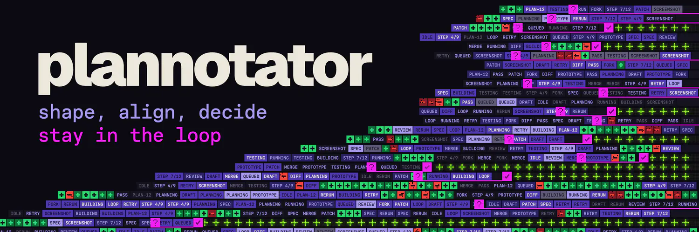
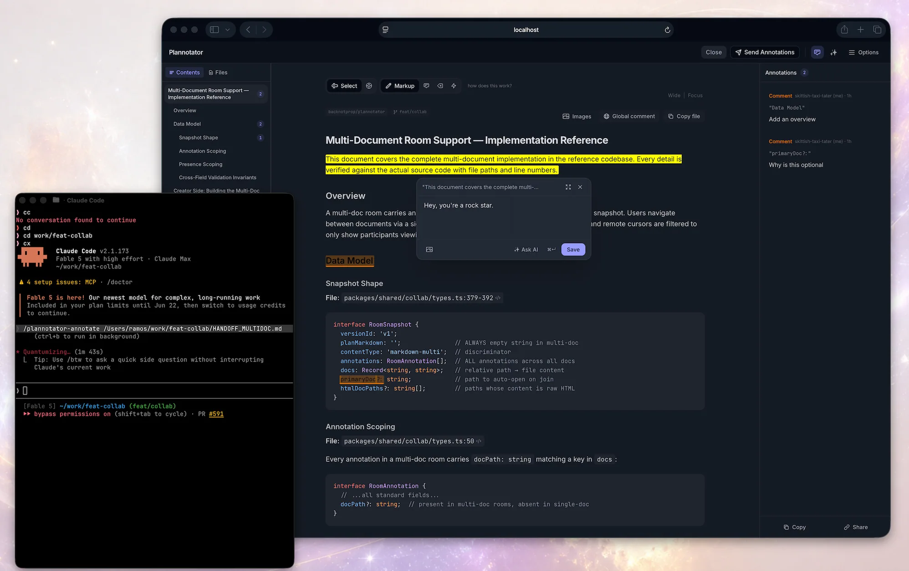
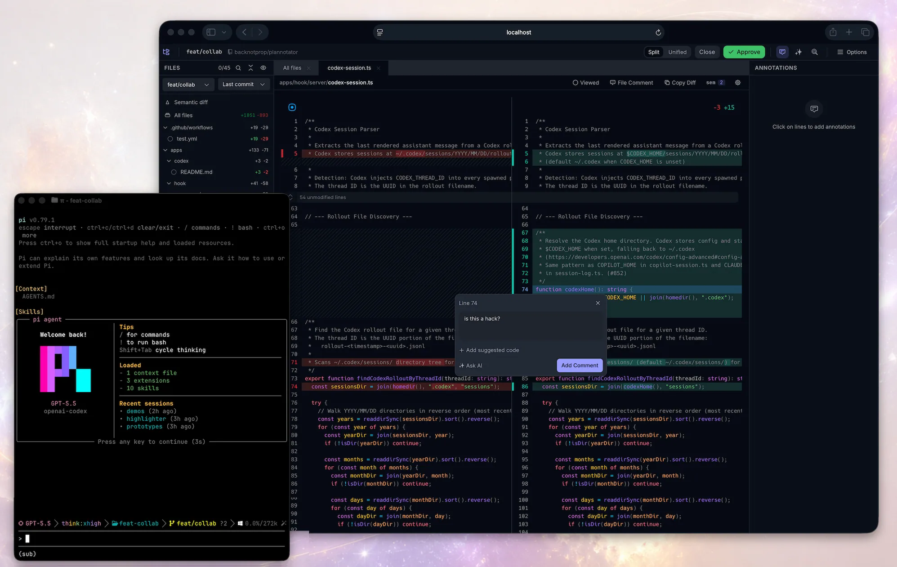
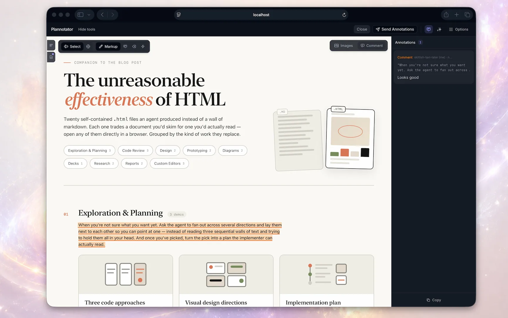
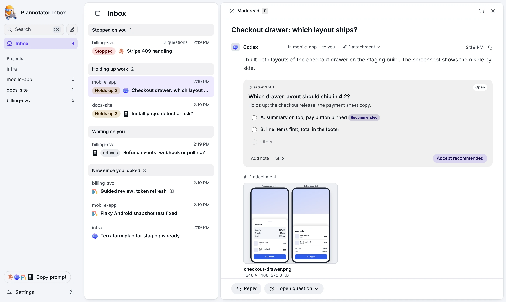
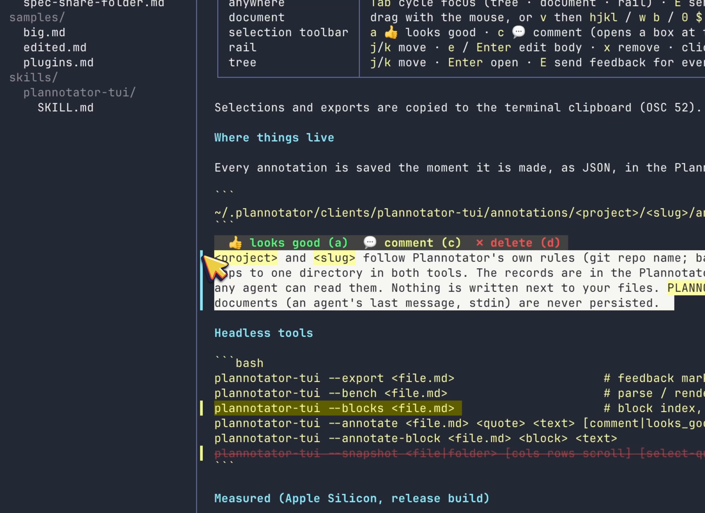
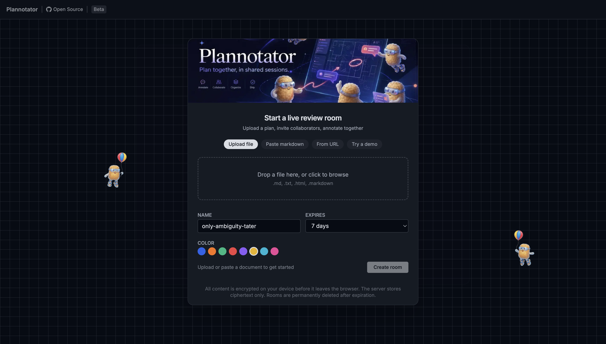

<p align="center">
  
</p>

<p align="center">
  <a href="README.md">English</a> | 简体中文
</p>

<p align="center">
  <strong>批注所需一应俱全，随时掌握智能体的工作进展</strong><br/>
  <strong>Inbox 界面 • 产物 • 代码审阅</strong><br/>
  <sub>为计划、规格说明、Markdown、HTML 和其他交互式产物添加批注。审阅差异和 PR。向智能体发送反馈。</sub>
</p>

<p align="center">
  &nbsp;&nbsp;
  &nbsp;&nbsp;
  &nbsp;&nbsp;
  <picture>
    <source media="(prefers-color-scheme: dark)" srcset=".github/assets/icons/copilot-dark.svg" />
    
  </picture>&nbsp;&nbsp;
  &nbsp;&nbsp;
  &nbsp;&nbsp;
  &nbsp;&nbsp;
  <picture>
    <source media="(prefers-color-scheme: dark)" srcset=".github/assets/icons/opencode-dark.svg" />
    
  </picture>&nbsp;&nbsp;
  <picture>
    <source media="(prefers-color-scheme: dark)" srcset=".github/assets/icons/pi-dark.svg" />
    
  </picture>
</p>

<p align="center">
  <a href="#plannotator-inbox">Plannotator Inbox</a> · <a href="https://plannotator.ai/">官方网站</a> · <a href="https://plannotator.ai/code-review">代码审阅</a> · <a href="https://github.com/plannotator/effective-html">Visual HTML Skills</a> · <a href="#herdr-annotate终端中的-plannotator">Herdr Annotate</a> · <a href="https://www.youtube.com/watch?v=a_AT7cEN_9I">（旧版）计划模式</a>
</p>

# Plannotator

**⭐️ 新功能：** [Plannotator Inbox](https://plannotator.ai/inbox/) 为你与多智能体工作之间补上审阅环节。它集中呈现决策、原型、变体、计划，以及掌握进展所需的一切内容。适用于所有编程智能体和个人助理。

Plannotator 是面向 AI 编程智能体的本地浏览器审阅界面，支持 Claude Code、Codex、Copilot CLI、Gemini CLI、OpenCode、Kiro、Droid、Amp、DeepSeek Harness 和 Pi。Plannotator Inbox 也支持个人助理（Grok Bot、Muse、Hermes、OpenClaw）。

**通过插件、钩子和命令，直接接入你的智能体。** 当智能体提出决策、计划、HTML 或完成工作时，应用会在浏览器中打开。你可以添加标记、评论，并将反馈直接发送给智能体，由它据此采取行动。

<table>
<tr>
<td width="40%" valign="middle">

### 审阅文档、计划和智能体消息

为计划、规格说明、消息、HTML 添加批注，然后将反馈发送给智能体。

<p><strong>演示：</strong> <a href="https://youtu.be/XqFun9XCXPw">使用 Pi 审阅计划</a></p>

</td>
<td width="60%">



</td>
</tr>
<tr>
<td width="40%" valign="middle">

### 代码审阅

审阅本地更改或远程 PR。在差异上发表评论、提出代码建议。你的评论会返回给智能体。支持 Git、GitButler、Jujutsu（`jj`）、Perforce（`p4`）、GitHub 和 GitLab。

</td>
<td width="60%">



</td>
</tr>
</table>

<p align="center">
  <sub><strong>内置 AI：</strong>就正在审阅的任何内容向 AI 提问，<br/>或发起 AI 审阅，将评论添加到差异中。</sub>
</p>

## 为 HTML 产物添加批注

<p align="center">
  
</p>

## Plannotator Inbox

<p align="center">
  <a href="https://plannotator.ai/inbox/">
    <picture>
      <source media="(prefers-color-scheme: dark)" srcset=".github/assets/inbox-dark.webp" />
      
    </picture>
  </a>
</p>

Plannotator Inbox 是一个本地窗口：智能体继续工作的同时，可以在这里给你留下消息、问题、文件和引导式审阅。点击即可回答问题，也可以为文件添加批注，有空时按下 Send（发送）。在此期间，智能体会话无需保持打开；你的回复会返回到提出问题的会话。

```
plannotator inbox
```

Claude Code、Pi 和 OpenCode 通过 Plannotator 插件连接，你的回复会作为它们的下一轮消息到达。其他智能体均可使用 `plannotator inbox mcp` 通过 MCP 接入，智能体可阅读 `plannotator inbox --help` 了解用法。[观看演示](https://plannotator.ai/assets/inbox-film.mp4) · [了解 Inbox](https://plannotator.ai/inbox/) · [文档](https://plannotator.ai/docs/reference/inbox/)

## Herdr Annotate：终端中的 Plannotator

<p align="center">
  <a href="https://github.com/plannotator/herdr-annotate">
    
  </a>
  &nbsp;&nbsp;
  
</p>

[Herdr Annotate](https://github.com/plannotator/herdr-annotate) 将 Plannotator 风格的审阅带到终端：在 [Herdr](https://herdr.dev) 中为终端文本添加批注、审阅完整的 Markdown 文档和编程智能体的回复，并将反馈直接作为下一条消息发送给智能体。支持 Claude Code、Codex、Pi、Copilot CLI 和 Droid 的回复。批注保存在 Plannotator 数据目录中，让终端审阅与应用内审阅的成果持续积累。

```
herdr plugin install plannotator/herdr-annotate
```

希望独立使用？[Plannotator TUI](https://github.com/plannotator/plannotator-tui) 提供文档审阅能力，无需 Herdr 即可运行：`brew install plannotator/tap/plannotator-tui`。

---

## 命令

<sub>在 Codex 中，将斜杠命令换成 `!plannotator …`（例如 `!plannotator review`）或 `$plannotator-*` 技能。</sub>

### 批注

```
/plannotator-annotate README.md                  # 本地 Markdown 文件
/plannotator-annotate src/                       # 浏览文件夹中的文件并添加批注
/plannotator-annotate https://docs.rs/…          # 获取任意 URL 的内容并添加批注
/plannotator-annotate report.html --render-html  # 按原样渲染 HTML，不进行转换
/plannotator-last                                # 为智能体的最后一条消息添加批注
```

想用一份真实文档试试？将[产品需求文档模板及填写示例](https://docs.plannotator.ai/templates/product-requirements-document)复制为 Markdown 即可。

### 代码审阅

```
/plannotator-review                    # 审阅尚未提交的更改
/plannotator-review <github-pr-url>    # 审阅 GitHub pull request
/plannotator-review <gitlab-mr-url>    # 审阅 GitLab merge request
plannotator review --gitbutler         # 审阅活动的 GitButler 工作区
plannotator review --patch-file reading.diff # 审阅调用方提供的静态 unified diff
```

GitButler 用户可以审阅整个工作区、单个堆栈或单个分支层。参见 [GitButler 工作流指南](https://docs.plannotator.ai/open-source/workflows/gitbutler)。

### 计划模式

无需命令。计划模式通过各智能体运行环境的钩子接入。每当智能体创建计划时，Markdown 审阅界面就会打开。

### CLI

```
plannotator sessions                   # 列出活动的 Plannotator 会话
plannotator sessions --open 1          # 在浏览器中重新打开会话
plannotator archive                    # 以只读方式浏览已保存的计划决策
```

---

## 隐私与网络行为

Plannotator 不收集使用遥测或分析数据。计划、差异、批注、草稿、历史记录和配置默认保留在本地。

计划审阅、批注、归档、分享门户和代码审阅界面每次加载时，都会向 GitHub 检查最新的 Plannotator 版本。此请求不发送计划或审阅内容，也不会向 Plannotator 项目所有者提供使用分析数据，但 GitHub 会收到一次普通请求。目前没有关闭版本检查的设置。本地 Git 代码审阅还可以通过 `git ls-remote` 查询已配置的 `origin`，以检测默认分支和过时的比较基准；此查询不会发送本地差异。远程查询会在打开审阅、页面加载差异、切换差异类型或基准（包括点击“Diff out of date &middot; Refresh”按钮），以及按下 Fetch 时运行；它从不定时运行，因此闲置的审阅页面不会发起网络调用。可以通过 `plannotator review --no-git-remote-check`、`PLANNOTATOR_GIT_REMOTE_CHECK=0`，或在 `~/.plannotator/config.json` 中设置 `{ "gitRemoteCheck": false }` 来完全关闭这项远程查询；此时比较目标仅来自本地引用，且不会出现“behind GitHub”横幅。

只有网络功能需要内容时，内容才会离开本地工作流：

- URL 批注会获取所请求的网站；对于公开页面，默认通过 Jina Reader 获取，禁用 Jina 或 Jina 不可用时则直接获取。
- GitHub 和 GitLab 审阅使用你已认证的 CLI 和 Git 远程仓库获取 PR 或 MR 数据。
- Ask AI 和审阅智能体会将所选问题及相关的计划、文档、仓库或差异上下文发送到你配置的服务提供方。当 Ask AI 由打开 Plannotator 的智能体会话回答时（“Ask this session”），问题会发送给该会话。
- 分享会将完整链接发送给你用于传递它的接收者或服务。加密短链接会将密文上传到粘贴服务。
- Workspaces 是独立的托管产品，因此开源应用的本地存储模式不适用于放入其中的内容。

[隐私政策](https://plannotator.ai/privacy)说明了这些边界，以及托管网站和候补名单的数据处理方式。

---

## 链接分享

开源版异步链接分享为保持兼容仍然可用，但正转入弃用支持阶段。Workspaces 是团队分享的主要发展方向。目前尚未公布移除日期。

<p align="center">
  <a href="https://room.plannotator.ai/">
    
  </a>
</p>

<p align="center">
  <sub>旧版链接分享演示：<a href="https://room.plannotator.ai/">room.plannotator.ai</a></sub>
</p>

<p align="center">
  <a href="https://plannotator.ai/workspaces">
    
  </a>
</p>

将计划分享给队友，他们就可以自行添加批注。导入他们的反馈后，即可直接发送给你的智能体。

**小型 Markdown 分享**会压缩到 URL 片段中。浏览器向分享门户发送的请求不包含该片段，但片段本身未加密。任何获得完整链接的人或消息服务都能读取分享内容。门户主机仍会收到普通请求的元数据。

**大型 Markdown 和原始 HTML 分享**使用短链接服务。分享载荷在上传前通过 AES-256-GCM 加密，服务器仅存储密文，密钥保留在 URL 片段中，不会在粘贴请求中发送。任何获得完整链接的人都能解密。托管的粘贴内容会在 7 天后过期。

其模式与 [PrivateBin](https://privatebin.info/) 相同。粘贴服务支持[自行托管](https://docs.plannotator.ai/open-source/workflows/sharing)。

设置 `PLANNOTATOR_SHARE=disabled` 可以完全关闭分享功能。

[Workspaces](https://plannotator.ai/workspaces) 是托管式团队协作的主要途径。

---

## 安装

一个安装程序即可覆盖几乎所有智能体。它会安装 `plannotator` 二进制文件，自动检测已安装的智能体，并为每个智能体配置钩子、技能和斜杠命令：

```bash
# macOS / Linux / WSL
curl -fsSL https://plannotator.ai/install.sh | bash
```

```powershell
# Windows PowerShell
irm https://plannotator.ai/install.ps1 | iex
```

安装程序从 GitHub Releases 下载二进制文件。完整安装还可能访问 GitHub，以解析发布版本并获取智能体文件；访问 Ataraxy-Labs/sem，以获取可选的 `sem` 配套程序；以及访问 npm，以获取 Pi、所选的额外技能或托管的智能体终端运行时。通过 `--version` 固定版本只会跳过 GitHub API 的版本解析，仍然会下载发布文件。完整的网络边界见[隐私政策](https://plannotator.ai/privacy)。

只想安装二进制文件？传入 `--minimal`（或导出 `PLANNOTATOR_MINIMAL=1`），即可仅将 `plannotator` 二进制文件安装到 `~/.local/bin`，跳过所有技能、钩子、斜杠命令和各智能体配置：

```bash
curl -fsSL https://plannotator.ai/install.sh | bash -s -- --minimal
```

然后完成对应智能体的步骤：

| 智能体 | 安装程序运行后的操作 | 详情 |
|---|---|---|
| **Amp** | 将 [`plannotator.ts`](apps/amp-plugin/plannotator.ts) 复制到 `~/.config/amp/plugins/`，然后执行 `plugins: reload`。工作流位于命令面板中。 | [README](apps/amp-plugin/README.md) |
| **Claude Code** | 执行 `/plugin marketplace add backnotprop/plannotator`，然后执行 `/plugin install plannotator@plannotator`。重启 Claude Code。 | [README](apps/hook/README.md) |
| **Codex** | 无需额外操作。计划审阅通过 Codex 的实验性 `Stop` 钩子自动启用（macOS/Linux/WSL；在原生 Windows 上，Codex 钩子属于实验性功能，安装程序会打印手动设置步骤）。包含 `$plannotator-review`、`$plannotator-annotate` 和 `$plannotator-last` 技能。 | [README](apps/codex/README.md) |
| **Copilot CLI** | 执行 `/plugin marketplace add backnotprop/plannotator`，然后执行 `/plugin install plannotator-copilot@plannotator`。重启。计划审阅在计划模式（`Shift+Tab`）中激活。 | [README](apps/copilot/README.md) |
| **DeepSeek Harness** | 在 DSH 的 Plugins 页面添加 `@plannotator/dsh`，或运行 `dsh plugin --profile <profile> add @plannotator/dsh`。调用 `exit_plan_mode` 时打开计划审阅。插件添加了 `/plannotator-review`、`/plannotator-annotate` 和 `/plannotator-last`，打开时不会阻塞会话。 | [README](apps/dsh-plugin/README.md) |
| **Droid** | 执行 `droid plugin marketplace add https://github.com/backnotprop/plannotator`，然后执行 `droid plugin install plannotator@plannotator`。目前仅支持命令，尚不支持拦截计划。 | [README](apps/droid-plugin/README.md) |
| **Gemini CLI** | 无需额外操作。钩子、策略和斜杠命令会自动配置。要求 Gemini CLI 0.36.0+。 | [README](apps/gemini/README.md) |
| **Kiro CLI** | 无需额外操作。技能和一个示例智能体会自动安装。可以尝试 `kiro-cli chat --agent plannotator`。 | [README](apps/kiro-cli/README.md) |
| **OpenCode** | 将 `"plugin": ["@plannotator/opencode@latest"]` 添加到 `opencode.json`。重启 OpenCode。 | [README](apps/opencode-plugin/README.md) |
| **Pi** | 跳过安装程序。只需执行 `pi install npm:@plannotator/pi-extension`。使用 `--plan` 启动 Pi，或通过 `/plannotator-plan-mode` 切换。 | [README](apps/pi-extension/README.md) |
| **T3 Code** | 对于 T3 中的 Claude 对话：运行 `plannotator t3 --help`，并按照其中的两个步骤操作（登录 T3 一次，添加 `--t3` MCP 条目）。随后，你的 Inbox 回复会作为新一轮消息到达对话。 | [README](packages/t3-code/README.md) |

**更新：** 再次运行安装程序以更新二进制文件和斜杠命令。当 PATH 中存在 `claude` 命令时，它也会更新已安装的 Claude Code 插件（可通过 `--skip-claude-plugin` 跳过）；否则，依次运行 `claude plugin marketplace update plannotator` 和 `claude plugin update plannotator@plannotator`，然后重启 Claude Code（仅刷新 marketplace 不会更新插件）。Pi：执行 `pi update --extensions`（单独执行 `pi update` 只会更新 Pi）。

在 Claude Code 2.1.287 或更新版本中，计划审阅、代码审阅和批注都不会让 Claude 等待：Claude 会结束当前轮次，你的决定稍后作为消息到达。设置 `PLANNOTATOR_CLAUDE_MOD=0` 可恢复经典流程。

完整操作指南见[安装文档](https://docs.plannotator.ai/open-source/start/installation)。

### 卸载

默认采用安全的卸载方式：移除可识别的、由 Plannotator 安装的组件，并保留本地计划、历史记录、草稿、引导和设置：

```bash
plannotator uninstall
```

使用 `--purge` 还可以彻底移除已知的本地 Plannotator 数据：

```bash
plannotator uninstall --purge
```

清除数据时，需要在提示处输入 `purge`。提示会说明数据仅保存在本地：Plannotator 服务器上没有存储这些数据，删除后无法恢复。
用于自动化时，传入 `--yes`（或 `-y`）；非交互式卸载在未传入该参数时会拒绝运行。使用 `--dry-run` 可以预览可识别的卸载操作，而不作更改。
宿主集成始终属于卸载范围。如果宿主损坏或不可用，导致无法安全清理，命令会指出造成阻塞的插件管理器或配置，给出准确的手动清理步骤，并在删除二进制文件之前停止。完成清理后重新运行卸载即可。
如果某个智能体的配置文件无法读取（也包括其他工具的配置文件），或某个并非由安装程序安装的钩子仍在运行 Plannotator，命令也会保留二进制文件。错误信息会指出文件、工具及应采取的操作。对于你自行添加的 `plannotator-inbox` 条目，或为单个项目安装的 Claude Code 或 Droid 插件，命令会指出其名称和移除方法，但它们不会导致保留二进制文件。
这些机制让常规确认默认选择“否”，让不可逆操作需要输入更明确的确认词，同时仍为包管理器和脚本提供常规的非交互式参数。

该命令覆盖 macOS、Linux、WSL 和 Windows 的常规二进制文件位置；托管的 `sem` 配套程序和智能体终端运行时；安装程序提供的技能、命令、钩子、策略、缓存及可识别的 Amp/Kiro 文件；以及通过各宿主 CLI 检测到的 Claude Code、Copilot CLI、Droid、Pi 和 VS Code 安装。
共享 JSONC 设置会被精确修改；严格 JSON 配置的更新则保留文件的缩进、换行符和末尾换行风格。
自定义或无法识别的文件、单独安装的可选技能、项目内集成、外部计划保存位置和无效配置会被保留（格式错误的宿主配置会触发安全停止错误）。如果清理报错，CLI 会继续保留，以便安全重试；其 Windows PATH 条目也会尽可能保留或恢复。如果 PATH 恢复本身失败，输出会给出用于重试的完整 CLI 路径，并要求手动修复 PATH。
为确保安全，清除操作拒绝处理文件系统根目录、主目录、共享临时目录、符号链接形式的数据目录，以及非目录的数据路径。
现有路径按文件系统身份进行比较，因此大小写别名、符号链接、硬链接和绑定挂载都无法绕过根目录、主目录及祖先目录检查。
等待宿主命令完成后、执行同步数据删除代码块之前，系统会重新验证这些身份及所有包含关系保护条件；如果数据目录已被替换，操作会拒绝继续，原数据和替换后的数据均不会被触碰。
如果专用数据目录是符号链接，请将 `PLANNOTATOR_DATA_DIR` 指向其解析后的目标，再重试。

如果仅安装了独立 Pi 扩展，且没有 `plannotator` CLI，请使用 `pi remove npm:@plannotator/pi-extension`。

<details>
<summary>Claude Code：手动配置钩子（不使用插件系统）</summary>

添加到 `~/.claude/settings.json`：

```json
{
  "hooks": {
    "PermissionRequest": [
      {
        "matcher": "ExitPlanMode",
        "hooks": [
          {
            "type": "command",
            "command": "plannotator",
            "timeout": 345600
          }
        ]
      }
    ]
  }
}
```

</details>

<details>
<summary>固定指定版本</summary>

```bash
curl -fsSL https://plannotator.ai/install.sh | bash -s -- --version vX.Y.Z
```

```powershell
& ([scriptblock]::Create((irm https://plannotator.ai/install.ps1))) -Version vX.Y.Z
```

</details>

### 试用

了解 Plannotator 功能最快的方式，就是现在从智能体中亲自调用它：

```
/plannotator-last                   # 为智能体的最后一条回复添加批注
/plannotator-review                 # 以 PR 风格审阅当前差异
/plannotator-annotate report.html   # 为任意文件、文件夹或 URL 添加批注
```

（大多数智能体中使用斜杠命令；Codex 中使用 `$plannotator-*` 技能，Amp 中使用命令面板。）

计划审阅完全无需命令。下次智能体提出计划时，它会自动在浏览器中打开。

---

## 工作原理

### 计划审阅

```
智能体调用 ExitPlanMode
  -> 触发 PermissionRequest 钩子
  -> 本地服务器从钩子输入读取计划
  -> 浏览器打开审阅界面
  -> 你添加批注并批准或拒绝
  -> 批准：智能体继续执行
  -> 拒绝：向智能体发送结构化反馈
  -> 智能体修改计划，计划差异视图显示更改内容
```

### 代码审阅

```
你运行 /plannotator-review
  -> git diff 捕获更改（或通过 URL 获取 PR）
  -> 浏览器打开差异查看器
  -> 为代码行添加批注，暂存或取消暂存文件
  -> Send feedback：反馈返回到智能体会话
  -> Approve：发送 "LGTM"
```

---

## 集成

**VS Code**：在编辑器标签页中打开计划、行内查看差异，并从编辑器行号栏添加批注。从 [VS Code Marketplace](https://marketplace.visualstudio.com/items?itemName=backnotprop.plannotator-webview) 安装。

**Obsidian**：自动将已批准的计划保存到库中，附带 YAML frontmatter、从计划标题生成的标签，以及用于连接关系图的反向链接。在 Plannotator 的 Settings 面板中配置。

**Bear**：将计划保存为 Bear 笔记，包含嵌套标签和项目元数据。

**Notion**：将计划保存为共享 Notion 页面下的 Markdown 子页面。在启动 Plannotator 的环境中设置 `NOTION_TOKEN`，然后在 Settings 中配置父页面。

**GitHub / GitLab**：将任意 PR 或 MR URL 传给 `/plannotator-review`，即可通过完整的差异查看器、批注和文件树进行审阅。

---

## 远程 / SSH / devcontainer

Plannotator 会自动检测 SSH 会话，并切换到固定端口 `19432`。如需使用其他端口，或在 devcontainer 或 Docker 中运行：

```bash
export PLANNOTATOR_REMOTE=1
export PLANNOTATOR_PORT=9999  # 转发此端口
```

VS Code devcontainer 会自动转发端口（查看 Ports 标签页）。直接使用 SSH 时，将以下内容添加到 `~/.ssh/config`；如果设置了 `PLANNOTATOR_PORT`，请使用对应端口值：

```
Host your-server
    LocalForward 19432 localhost:19432
```

在远程模式下，服务器会监听所有网络接口（`0.0.0.0`），且无需登录，因此任何能访问该端口的人都能使用它，即便你使用了 SSH 隧道也是如此。请阻止不受信任的网络访问该端口。

---

## 安全

每个发布的二进制文件都附带一个 SHA256 校验文件。从 v0.17.2 起提供 [SLSA 来源证明](https://slsa.dev/)。当前的发布工作流还会附加 CycloneDX JSON SBOM，在生成任何证明或发布任何内容前，使用最新的 Grype 数据库对其进行评估，并为发布的二进制文件和 npm tarball 创建 GitHub/Sigstore SBOM 证明。

SBOM 明确标注为覆盖整个发布版本的 Syft 清单，列出此 monorepo 中锁定的构建输入和依赖。它并非各二进制文件精确的运行时清单：Bun 独立可执行文件不会向 Syft 暴露其捆绑的 JavaScript 包元数据。权威的[安装与验证文档](https://docs.plannotator.ai/open-source/start/installation#pin-or-verify-a-release)涵盖现有安装流程；下方列出了新增 SBOM 的确切命令，必须在首次启用 SBOM 的发布之前，将它们复制到该 Mintlify 页面。

发布门禁会拒绝扫描器端被忽略的匹配项；在评估 CISA KEV 和可修复的 Critical 级发现时，会将适用范围未知的项保守地视为运行时项。明确的 Grype 配置、完整 JSON 结果、数据库状态和仓库策略判定均会保留为工作流证据。

直接验证已发布的 Linux x64 二进制文件、其现有来源证明及新增 SBOM 证据：

```bash
tag=vX.Y.Z
version="${tag#v}"
mkdir -p /tmp/plannotator-release-verify
gh release download "$tag" --repo backnotprop/plannotator \
  --pattern 'plannotator-linux-x64*' \
  --pattern "plannotator-${version}-release-sbom.cdx.json*" \
  --dir /tmp/plannotator-release-verify

(cd /tmp/plannotator-release-verify && sha256sum --check plannotator-linux-x64.sha256)
(cd /tmp/plannotator-release-verify && sha256sum --check "plannotator-${version}-release-sbom.cdx.json.sha256")

gh attestation verify /tmp/plannotator-release-verify/plannotator-linux-x64 \
  --repo backnotprop/plannotator --source-ref "refs/tags/$tag" \
  --signer-workflow backnotprop/plannotator/.github/workflows/release.yml \
  --predicate-type https://slsa.dev/provenance/v1

gh attestation verify /tmp/plannotator-release-verify/plannotator-linux-x64 \
  --repo backnotprop/plannotator --source-ref "refs/tags/$tag" \
  --signer-workflow backnotprop/plannotator/.github/workflows/release.yml \
  --predicate-type https://cyclonedx.org/bom
```

这些是针对同一产物摘要的不同声明：来源证明标识构建者、源代码和工作流，CycloneDX 谓词则描述整个发布版本的清单。发布操作手册还会使用 `jq -S` 规范化已下载的 SBOM 和经证明的谓词，并进行比较。

安装时进行验证：

```bash
curl -fsSL https://plannotator.ai/install.sh | bash -s -- --verify-attestation
```

需要 `gh` CLI，但无需登录：安装程序从 GitHub 公开的 attestations API 获取证明包，并通过 `gh attestation verify --bundle` 验证（提取时需要 PATH 中有 node、python3 或 jq；回退方式为使用 gh 的已认证请求）。也可以在 `~/.plannotator/config.json` 中持久设置：

```json
{ "verifyAttestation": true }
```

安装程序的验证仍需主动启用，验证内容为 SLSA 构建来源；常规安装不需要 `gh`。详见[权威安装文档](https://docs.plannotator.ai/open-source/start/installation#pin-or-verify-a-release)。

---

## 配置

由于每次钩子调用都运行在随机端口上，设置保存在 cookie 中（而非 localStorage）。你也可以通过环境变量或 `~/.plannotator/config.json` 设置选项。

### 可选的 Vim controls

计划和批注视图在 **Settings → Vim** 下提供默认关闭的 **Vim controls** 配置。
启用后，让文档获得焦点，即可使用 `j` / `k` 每次移动一个渲染块。使用 `l` 深入某个语义层级后，`j` / `k` 会在同级的行、单元格或行内目标之间移动；`h` 则返回包含当前目标的上级目标。继续深入至最底层目标之后，会进入文本。
`v` 开始按字符的 Visual 选择，`V` 选择整个块。`Space` 打开常规批注工具栏；`c`、`d`、`m` 和 `t` 分别选择评论、修订标记、标记和标签操作。
指针 Pinpoint 与键盘导航使用同一套语义目标图。在文档中按 `?` 可查看当前上下文的按键参考。输入框、对话框、编辑器、`Tab` 和所有指针交互均保持原生行为。
页面未聚焦于其他控件时，文档会自动获得焦点；在应用周边控件中按 `Escape`，无需点击即可返回文档。
Vim controls 下方还有一个默认关闭的 **Vim HUD** 开关。它以产品演示的样式显示实时目标准星和导航上下文。
右下角的 **Key panel** 可以单独隐藏，同时保持准星启用；按 `?` 仍可按需打开完整键位表。该面板显示最近处理的按键、当前块/行/词/Visual 阶段及命令含义，不会捕获在评论或其他控件中输入的文本。
交互约定和实现架构见 [Vim controls](docs/vim-controls.md)。

| 变量 | 说明 |
|---|---|
| `PLANNOTATOR_REMOTE` | `1`/`true` 表示远程模式，`0`/`false` 表示本地模式，不设置则自动检测 SSH |
| `PLANNOTATOR_PORT` | 固定端口（默认：本地随机，远程为 `19432`） |
| `PLANNOTATOR_BROWSER` | 用于打开计划的自定义浏览器。设为 `none`（或 `false`、`0`、`off`、`no`、`true`、`1`、`:`）时完全不打开浏览器；会话 URL 始终会打印。 |
| `PLANNOTATOR_AI` | 设为 `disabled` 可禁用 Ask AI、Review Agents 和 Guided Review；批注智能体终端独立于此设置 |
| `PLANNOTATOR_SHARE` | 设为 `disabled` 可关闭 URL 分享 |
| `PLANNOTATOR_SHARE_URL` | 分享链接的自定义基础 URL（自行托管的门户） |
| `PLANNOTATOR_PASTE_URL` | 粘贴服务 API 的基础 URL |
| `PLANNOTATOR_ORIGIN` | 覆盖智能体检测结果：`claude-code`、`amp`、`droid`、`opencode`、`codex`、`copilot-cli`、`gemini-cli`、`kiro-cli`、`pi` |
| `PLANNOTATOR_JINA` | `0`/`false` 可禁用 URL 批注的 Jina Reader |
| `JINA_API_KEY` | Jina Reader API 密钥，用于提高请求速率限制 |
| `PLANNOTATOR_DATA_DIR` | Plannotator 管理文件的基础目录（计划、历史记录、草稿、`config.json`）。默认：`~/.plannotator`；如果该目录不存在，且 `$XDG_DATA_HOME` 被设为绝对路径，则使用 `$XDG_DATA_HOME/plannotator`（当 `~/.plannotator` 不含任何 Plannotator 数据，而 XDG 文件夹中有数据时也如此）。`plannotator data-dir` 会打印正在使用的文件夹 |

Plannotator 管理的文件默认位于 `~/.plannotator` 下。一些界面偏好保存在功能性浏览器 cookie 中。如需迁移这些文件（例如让主目录符合 XDG 习惯）：

```bash
export PLANNOTATOR_DATA_DIR=~/.local/share/plannotator
```

---

## 开发

```bash
bun install

bun run dev:hook       # 计划审阅服务器
bun run dev:review     # 代码审阅编辑器
bun run dev:marketing  # 营销网站（plannotator.ai）
bun run dev:vscode     # VS Code 扩展（监视模式）
```

### 构建

```bash
bun run build          # 主要构建目标（hook + opencode + dsh）
bun run build:hook     # 钩子服务器的单文件 HTML
bun run build:review   # 代码审阅编辑器
bun run build:opencode # OpenCode 插件
bun run build:dsh      # DeepSeek Harness 插件
bun run build:vscode   # VS Code 扩展
```

构建顺序很重要。hook 构建会从 `apps/review/dist/` 复制预先构建的 HTML。如果更改了 `packages/ui/`、`packages/editor/` 或 `packages/review-editor/` 中的界面代码，请先重新构建 review 应用：

```bash
bun run --cwd apps/review build && bun run build:hook
```

在本地测试插件：

```bash
claude --plugin-dir ./apps/hook
```

完整的二进制文件构建：

```bash
bun run --cwd apps/review build && bun run build:hook && \
  bun build apps/hook/server/index.ts --compile --outfile ~/.local/bin/plannotator
```


---

## 许可

版权所有 2025-2026 backnotprop

采用 [Apache 2.0](LICENSE-APACHE) 或 [MIT](LICENSE-MIT) 双重许可，你可以任选其一。

除非你明确另作声明，贡献内容也采用相同条款的双重许可。
